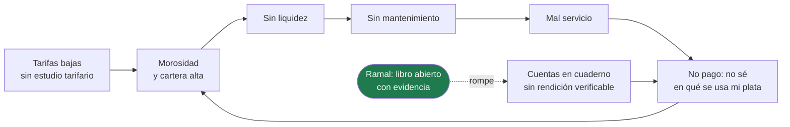
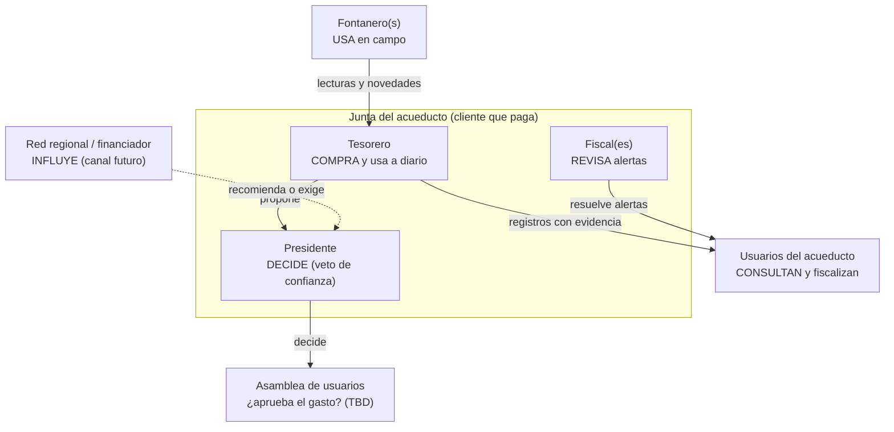
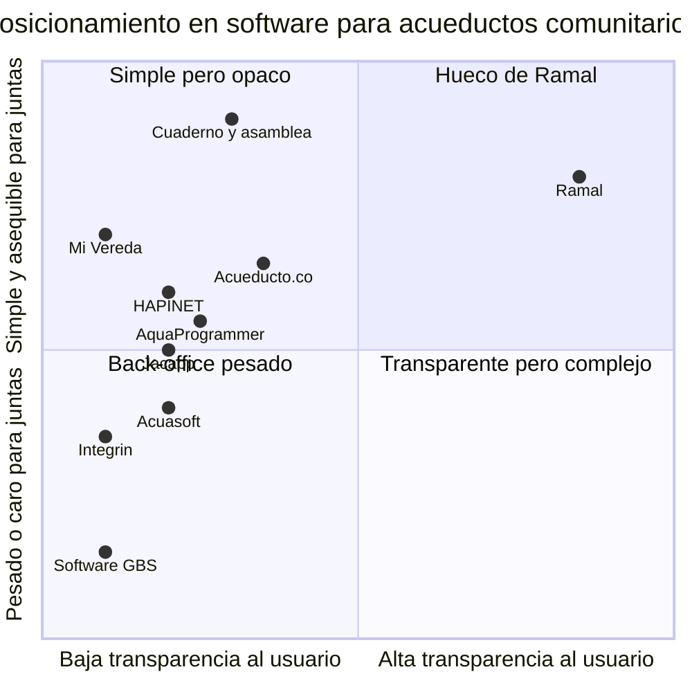
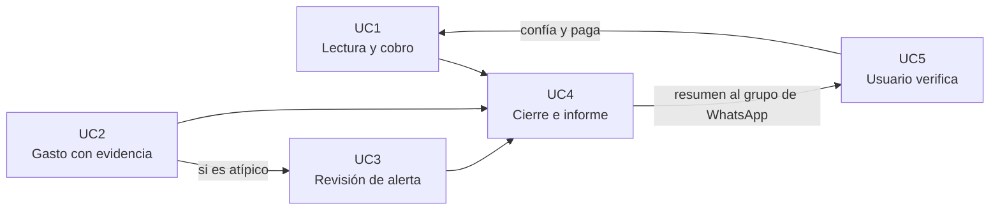
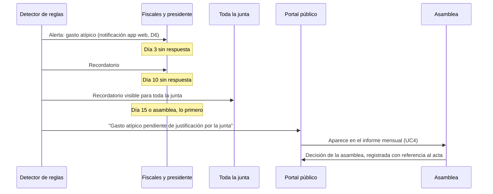

# PRD v1 — Ramal

> Estado: **en co-creación** (segmento a segmento). Fuentes: `docs/hcai-c2-product-vision-board.md` (PVB), `docs/icp.md` (ICP), `docs/deep-research-validacion.md` (VAL), `docs/deep-research-critica.md` (CRI), `docs/deep-research-validacion-critica-version-anterior.md` (ANT).

---

## 0. Registro de decisiones (Paso 0 — Análisis de conflictos)

Decisiones aprobadas antes de redactar el PRD. Si un segmento contradice esta tabla, prevalece la tabla.

| # | Tema | Decisión |
|---|---|---|
| A1 | Unit economics | El costo se modela **por junta**, no por afiliado. El supuesto del PVB (costo $300–900 vs. ingreso $100–250 COP/afiliado con margen 75%) es inconsistente y se descarta. Costo real = **TBD**, con escenarios en el Segmento 8/13; el soporte es el costo dominante (CRI §4). |
| A2 | Gratis vs. pago | **Reverse Trial de 60 días → pago.** Sin tier gratuito permanente. El piloto de la vereda paga desde el inicio. |
| A3 | Curva de precios (hipótesis) | Cuota plana por tamaño: **≤150 afiliados $35.000 · 151–400 $80.000 · 401–800 $120.000 COP/mes**. Alineado con el 0,5–1% del recaudo (ICP/VAL). |
| A4 | Publicación | Los registros humanos (ingresos/egresos con evidencia) se publican **al instante, sin veto de la junta**. Lo que genera el sistema (informe mensual por plantilla, alertas de anomalía) pasa **siempre por revisión humana** antes de presentarse como cerrado. El sistema nunca emite veredictos. |
| A5 | Visibilidad de alertas | **Separación de funciones:** quien registró el gasto ve la alerta pero no puede cerrarla. La resuelve **cualquiera de los fiscales (uno o más) o el presidente** — el piloto **sí tiene fiscal**. La resolución (justificación + evidencia) queda permanente y visible en el libro. Alerta sin resolver en **N días → se publica** en tono neutro ("Gasto atípico pendiente de justificación por la junta"); N propuesto = 15 días o la siguiente asamblea, lo que ocurra primero. **Requisito de UX:** fiscal y presidente pueden tener muy poca pericia digital → la revisión debe ser extremadamente simple (ver Segmento 6). |
| A6 | Validación | Se mantiene: **sin entrevistas externas antes del MVP**. El PRD declara que las hipótesis de precio y de pitch no son validables con n=1; se suman 3–5 tesoreros de la red regional entre los días 31–60. |
| A7 | Canal del usuario final | **Piloto: portal web público + resumen mensual que la junta reenvía manualmente** al grupo de WhatsApp de la vereda (Ramal genera el texto y el enlace; costo de operación ≈ cero, sin integración). El portal es la fuente de verdad; el mensaje solo avisa. Se mide el envío por las visitas que llegan desde ese enlace. **Futuro (add-on de pago):** integración con la API de WhatsApp Business (envío automático) y bot conversacional, orientados a acueductos más grandes, que se activan solo después de un estudio de rentabilidad que confirme que reducen la carga operativa. Principio rector: **costo de operación mínimo en el piloto**. |
| A8 | Uso de AI | **Principio: AI solo donde tenga una razón de ser; no se fuerza.** Los datos contables deben ser exactos, por lo que el **informe mensual se genera con una plantilla determinística** (cifras, tablas y fotos del mes), sin LLM. **Piloto: cero LLM.** La inteligencia del piloto es el **detector de anomalías por reglas + estadística simple** (sin costo de modelo). **Futuro (add-on, sujeto a estudio de rentabilidad y reducción de carga operativa):** bot de consultas para usuarios, lectura de recibos por foto, transcripción de notas de voz. |
| A9 | Datos del piloto | **TBD** (afiliados, tarifa, morosidad actual, fontaneros, conectividad, municipio, inscripción SINAS/RUPS/SSPD, existencia de fiscal). Su recolección es entregable de los días 1–30. Sin baseline de morosidad no hay North Star medible. |
| B1 | ICP | **100–800 afiliados** (sweet spot 150–500). Se actualiza el PVB (100–5.000). |
| B2 | Encuadre | Titular = **confianza y blindaje**; la reducción de corrupción es un resultado, no el titular. |
| B3 | Comprador del MVP | **La junta** (presidente decide, tesorero usa). Canal institucional = hipótesis LOI; en el MVP solo exportación/reporte. |
| B4 | Integridad | Promesa honesta: sello al capturar en el dispositivo + evidencia obligatoria + **anclaje externo del hash cabeza** (mensaje mensual de WhatsApp / acta de asamblea). El hash detecta alteraciones posteriores, no datos falsos de origen. |
| B5 | Egresos sin recibo | Foto obligatoria del recibo **o** del bien/obra; sin recibo → declaración + marca pública **"sin soporte"**. |
| B6 | Anuncios | **Won't Have.** |
| B7 | Métrica del informe mensual | Se elimina "informes AI aceptados sin edición >70%" (ya no hay informe por AI). Se mide **% de meses con informe publicado** + **tiempo de preparación del informe** (de días a minutos). |
| B8 | Precisión de anomalías | En el piloto solo se mide **tasa de falsos positivos de alertas revisadas**; meta de precisión >90% aplica a partir de ≥10 juntas. |
| B9 | Alcance regulatorio | Facturación electrónica DIAN: **ver D2** (reemplaza la decisión original de facturación interna sin DIAN). SUI fuera del MVP. Publicación de resultados IRCA en el portal = *Should*. |
| B10 | Recaudo | Registro manual de pagos (efectivo/transferencia) + recibo digital. Sin pasarela de pagos en el MVP. |
| B11 | Integrin | Integración = **Won't Have** en el MVP; importación CSV genérica = *Could*. |
| B12 | Competencia | Se usan los **8 competidores** (VAL + PVB + ANT). Diferenciador formulado como "ningún competidor ofrece un portal donde el usuario **fiscalice egresos**" (portal de pagos ≠ fiscalización). Verificado a sep. 2026; re-verificar antes del lanzamiento. |
| C1 | Número de acueductos | **~12.000** (Mongabay 2025); 3.649 inscritos en SINAS, ~1.919 ante la SSPD. |
| C2 | Rotación de juntas | **Cada 2 años** (confirmar en piloto). |
| C3 | Cita 30–40% | *Lockwood (2019), citado en estudios 2025.* |
| C4 | Docs faltantes | No hay `overview.md`, `mercado.md` ni transcripciones; verbatims del ICP = TBD. |
| C5 | Sync offline | El diseño contempla **uno o varios fontaneros**; la resolución avanzada de conflictos de sincronización se prioriza según cuántos tenga el piloto (TBD). |
| D1 | Alcance offline (Seg. 1) | **Offline-first aplica a la app del fontanero** (lecturas de contadores y novedades en campo sin cobertura). El tesorero/junta (facturación, recaudo, gastos) opera **con conexión**; no se exige offline para ese flujo. |
| D2 | Facturación ante la DIAN (Seg. 4) | **MVP: documento equivalente de servicios públicos domiciliarios en forma física**, generado por Ramal, sin integración con la DIAN y sin costo. Base legal: Res. DIAN 000165 de 2023, **art. 67, parágrafo** (adicionado por Res. 189 de 2024): acueductos comunitarios, veredales, rurales, asociaciones y pequeños prestadores con **<2.500 suscriptores** pueden seguir expidiéndolo en forma física — todo el ICP cumple. Requisitos mínimos: (1) nombre y NIT del acueducto; (2) numeración consecutiva interna; (3) fecha y hora; (4) descripción del cobro (descuentos, financiación, subsidios, otros cargos); (5) valor total; (6) **NIT y nombre del fabricante del software y nombre del software** → **Ramal debe estar constituido como empresa con NIT**. **Entrega:** el PDF enviado por WhatsApp vale como documento físico (validado por el creador); también se puede imprimir. Método de envío: ver D4. **Facturación electrónica: integración a corto plazo** (inmediatamente después del MVP), habilitando a cada acueducto en el modo **"Software propio"** de la DIAN — jurídicamente, *desarrollo informático adquirido* con Ramal como fabricante (art. 28, num. 2.1; Concepto DIAN 13246 de 2025). **Ramal no será proveedor tecnológico** (no cumple los requisitos del art. 55). Diseño para mitigar la zona gris del **art. 63**: **la junta emite** (su habilitación, su certificado de firma digital, su acción de emitir); Ramal es la herramienta y guía la habilitación y el set de pruebas con un asistente. Certificado de firma digital = costo de la junta. El piloto **no factura electrónicamente hoy**. **TBD:** concepto de asesor tributario antes de lanzar el módulo electrónico (no bloquea el MVP). |
| D3 | Conceptos de cobro y financiación | Además del consumo, el acueducto cobra otros conceptos de su operación normal: **derechos de conexión, reconexión, venta o financiación del medidor (contador), financiación de bienes (p. ej. tanque plástico), multas y sanciones** (nunca por no pago, ver D5), y otros configurables. Ramal maneja un **catálogo de conceptos configurable por junta** y **planes de financiación en cuotas** que se cargan en el documento mensual (saldo y cuota n de m). **Clasificación fiscal por concepto:** los *inherentes al servicio* van en el documento equivalente (el art. 20, num. 11 incluye "financiación, subsidios, otros cargos e ingresos asociados"); los *no inherentes* (p. ej. venta de un tanque) solo pueden ir en el documento equivalente **con autorización expresa del usuario y si la regulación lo permite** (art. 20, par. 2, adicionado por Res. 202 de 2025); si no, documento aparte. **Transparencia:** todos los ingresos aparecen **agregados por concepto** en el libro abierto; multas, deudas y financiaciones **individuales nunca son públicas** (Ley 1581 de 2012). **TBD (asesor tributario):** clasificación por defecto de cada concepto y si el límite del art. 20, par. 2 (redactado para el documento *electrónico*) aplica también al físico. |
| D4 | Envío de documentos de cobro | Los documentos individuales **nunca se envían al grupo de WhatsApp** (privacidad); solo 1 a 1. **Piloto (costo cero, sin API):** (a) **envío asistido** — Ramal genera por cada usuario un enlace de WhatsApp con mensaje prellenado y un enlace seguro al PDF; el tesorero lo envía con un toque desde su propio WhatsApp; (b) **impresión** para quien no tenga WhatsApp; (c) consulta en el portal con un código personal. El enlace al PDF es único y no adivinable, y solo muestra datos del titular. Se mide el tiempo que le toma al tesorero (≈1 toque por afiliado al mes); si la carga es alta, la API de WhatsApp Business es el add-on de pago previsto en A7. Requiere **autorización de tratamiento de datos** (número de WhatsApp) de cada usuario, conforme a la Ley 1581 de 2012. |
| D5 | Financiación, intereses y mora | **Motor de reglas configurable por junta, por concepto y por plan**: interés de financiación y de mora (independientes), inicio desde el día 1, tras un periodo de gracia o al vencer el plazo, base de cálculo, tasa, abonos, refinanciaciones y condonaciones. Con **validación de topes legales** y **trazabilidad completa** en el libro. Detalle en la sección 0.1. |
| D6 | Aviso de alertas a revisores (Seg. 5) | Sin API de WhatsApp en el piloto (A7), las alertas llegan a fiscales y presidente por **notificación de la app web** (sin costo) y quedan visibles al abrir Ramal. El respaldo es la publicación automática a los N días (A5). Si los revisores no instalan la app o no ven las notificaciones, se evalúa el aviso por WhatsApp dentro del add-on de A7. |
| D7 | Estructuras tarifarias del agua | **Motor de tarifas configurable por junta**: cuota fija sin medición, cargo fijo + precio por m³, básico incluido + excedente, bloques escalonados (incrementales o por volumen total), consumo mínimo y combinaciones; diferenciado por uso, estrato y temporada; con reglas para consumo estimado, medidor compartido y prorrateo. Tarifa **versionada, no retroactiva, pública** y respaldada por acta de asamblea. Respeta la metodología CRA para pequeños prestadores y zona rural (Res. CRA 825 de 2017 y 844 de 2018). Detalle en la sección 0.2. |
| D8 | Cancelación o no pago de una junta (Seg. 6, P9) | El historial público queda **en solo lectura** (propuesto: 10 años; TBD confirmar plazo) y es exportable. Cancelar no apaga la transparencia. |

### 0.1 Reglas de financiación, intereses y mora (detalle de D5)

**Ejemplo que debe soportar (aportado por el creador):** se financia un derecho de agua sin interés durante 12 meses; si al cumplirse el año el usuario no ha terminado de pagar, empieza a causarse interés mensual sobre lo adeudado. Otro acueducto puede querer cobrar interés desde el primer día. Todo esto debe ser configurable.

**1. Parámetros configurables**

| Parámetro | Opciones |
|---|---|
| Nivel de configuración | Regla por defecto de la junta → regla por concepto (conexión, medidor, tanque, consumo…) → ajuste por plan individual |
| Tipos de interés (independientes) | **Financiación** (interés pactado por el plazo) y/o **mora** (sobre lo vencido); cada uno se activa o no |
| Inicio del interés | Desde el día 1 · tras un periodo de gracia de N meses · al vencer el plazo total del plan sin haber pagado · al vencer cada cuota |
| Base de cálculo | Saldo total adeudado · solo cuotas vencidas · capital pendiente |
| Tasa | Fija mensual o anual, con validación de topes (punto 2) |
| Estructura del plan | Cuota inicial, número de cuotas, valor de cuota, fecha de inicio, día de corte, redondeo |
| Abonos anticipados | Reducen el plazo o el valor de la cuota (configurable) |
| Pagos parciales | Se imputan primero a intereses y luego a capital (regla general del Código Civil, art. 1653) |

**2. Topes y reglas legales que Ramal valida** (advierte o bloquea configuraciones que los superen)

| Regla | Fuente |
|---|---|
| El cobro de interés de mora es **facultativo**: el acueducto puede cobrarlo, rebajarlo o no cobrarlo | Ley 142 de 1994, art. 96; Concepto SSPD 91 de 2022 |
| **Usuarios residenciales:** interés de mora del Código Civil, **6% anual** si no se pacta otro; se puede pactar una tasa inferior | Código Civil, art. 1617; Concepto SSPD 91 de 2022 |
| **Usuarios no residenciales** (comercial, industrial): doble del interés bancario corriente certificado por la Superfinanciera, **sin exceder la tasa de usura** | Concepto SSPD 91 de 2022 |
| Acuerdos de pago y financiaciones: se rigen por derecho privado (plazo, forma de pago, cobro o renuncia de intereses); nunca por encima de la tasa de usura | Concepto SSPD 91 de 2022 |
| **Solo se condonan intereses de mora; el capital nunca** se descuenta | Concepto SSPD 91 de 2022 |
| **Por no pago, la única sanción monetaria es el interés de mora**: Ramal no permite configurar "multas por no pago". Las multas por otras causas (fraude, conexión no autorizada) dependen del reglamento o contrato de condiciones uniformes | Concepto SSPD 16 de 2022 |
| Sin capitalización de intereses (interés simple) por defecto | Ley 142, art. 96 (parcialmente inexequible, Sentencia C-389 de 2002); Concepto SSPD 302 de 2008 — **TBD: confirmar con asesor** |

Las tasas de referencia (interés bancario corriente y usura) cambian periódicamente; **TBD:** actualización manual por la junta o tabla mantenida por Ramal.

**3. Eventos que el motor debe manejar**

| Evento | Comportamiento |
|---|---|
| Refinanciación / acuerdo de pago | Crea un plan nuevo que consolida el saldo; el plan anterior queda cerrado con rastro, nunca borrado |
| Condonación de intereses de mora | La propone un miembro de la junta y la **aprueba otro distinto** (presidente o fiscal); genera alerta y queda en el libro (mismo principio de separación de funciones de A5) |
| Reclamo en curso del usuario | Marca el saldo en disputa — **TBD:** tratamiento de la mora sobre lo reclamado (Ley 142, art. 155) |
| Cambio de titular o venta del predio | **TBD:** traslado de la deuda y solidaridad entre propietario y usuario (Ley 142, art. 130) |
| Cambio de reglas de la junta | **No es retroactivo**: cada plan conserva la regla vigente al crearse. El cambio queda en el libro con referencia al acta de asamblea que lo aprobó |

**4. Transparencia y privacidad**
- En el documento de cobro, los intereses aparecen como **líneas separadas** ("intereses de financiación", "intereses de mora").
- Cada usuario ve **su** plan (saldo, cuotas pagadas y pendientes, intereses) en su documento y en el portal con su código.
- El portal público muestra solo **agregados**: cartera financiada, intereses cobrados y **total condonado del mes**, sin nombres. Así una condonación a un amigo de la junta no pasa desapercibida.

### 0.2 Estructuras tarifarias del servicio de agua (detalle de D7)

**Ejemplo que debe soportar (aportado por el creador):** hasta cierta cantidad de metros cúbicos se cobra una tarifa; si el usuario se pasa, se cobra una tarifa adicional por cada metro cúbico de exceso. Cada acueducto tiene su propio esquema, y Ramal debe cubrir los distintos escenarios.

**Marco regulatorio** (Ramal lo respeta por defecto, principio P8):
- La metodología tarifaria de la CRA para pequeños prestadores (Res. CRA 825 de 2017, modificada por la **Res. CRA 844 de 2018**) aplica a quienes atienden hasta 5.000 suscriptores en zona urbana y a **todos los prestadores de zona rural**, e incorpora **esquemas diferenciales rurales**.
- La tarifa se compone de un **cargo fijo** (disponibilidad del servicio, independiente del uso) y un **cargo por consumo**.
- El **consumo básico** depende del clima: **11 m³** (frío), **13 m³** (templado) y **16 m³** (cálido) (concepto CRA). Quien adopte esquemas diferenciales debe garantizar el volumen del consumo básico.
- En estratos subsidiables, el subsidio puede aplicarse al cargo fijo y al cargo por consumo, pero **en el consumo no puede exceder el consumo básico**.
- **TBD (asesor regulatorio):** topes vigentes de subsidios y contribuciones por estrato, y reglas para cobrar sin medición.

**1. Modelos de cobro que Ramal soporta**

| Modelo | Cómo funciona | Ejemplo |
|---|---|---|
| **Cuota fija** (sin medición) | Valor mensual igual para todos o por categoría; no usa lecturas | $15.000 al mes por vivienda |
| **Cargo fijo + precio único por m³** | Cargo de disponibilidad + todos los m³ al mismo precio | $8.000 + $1.200 por m³ |
| **Básico incluido + excedente** | La cuota cubre hasta X m³; cada m³ adicional se cobra aparte | $15.000 incluye 20 m³; cada m³ adicional, $1.500 |
| **Bloques escalonados incrementales** | Cada m³ se cobra al precio del bloque en que cae | 0–16 m³ a $1.000; 17–32 m³ a $1.500; más de 32 m³ a $2.500 |
| **Bloques por volumen total** | Todo el consumo se cobra al precio del bloque alcanzado | Si consume 20 m³, los 20 se cobran a $1.500 |
| **Consumo mínimo facturable** | Se cobra un mínimo de m³ aunque se consuma menos | Mínimo 10 m³ al mes |
| **Combinaciones** | Cualquier modelo + cargo fijo + cargos adicionales | Cargo fijo + bloques + cargo de saneamiento |

> [!NOTE]
> El ejemplo del creador corresponde a **"básico incluido + excedente"**. La diferencia entre bloques **incrementales** y **por volumen total** cambia mucho el valor a pagar; Ramal debe mostrarle a la junta, con un ejemplo, cómo queda la factura antes de guardar la regla.

**2. Dimensiones que diferencian la tarifa**

| Dimensión | Opciones |
|---|---|
| **Uso o clase** | Residencial · comercial · industrial · oficial o institucional (escuela, puesto de salud) · especial o agropecuario (riego, abrevadero) · otros configurables |
| **Estrato** | Subsidios (descuento) para estratos subsidiables y contribuciones (sobrecargo) para los que aportan, dentro de los topes legales (TBD) |
| **Temporada** | Tarifa o desincentivo al consumo excesivo en épocas de escasez (*Could*) |
| **Cargos adicionales** | Saneamiento o alcantarillado, otros cargos fijos aprobados por la asamblea |

**3. Escenarios operativos**

| Escenario | Comportamiento |
|---|---|
| **Sin lectura** (medidor dañado, sin acceso, fontanero no pudo llegar) | Consumo estimado con regla configurable (promedio de los últimos N meses); el documento lo marca como **"estimado"** y se ajusta cuando haya lectura real — **TBD:** límites legales de la estimación (Ley 142, art. 146) |
| **Medidor compartido** (varias viviendas, un medidor) | Consumo dividido entre las viviendas asociadas (partes iguales o por porcentaje) |
| **Usuario sin medidor** en un acueducto con medición | Se le aplica la cuota fija o el consumo estimado configurado para su categoría |
| **Consumo atípico** (posible fuga interna) | Alerta al fontanero y al usuario antes de cobrar (misma lógica de UC1, paso 2) |
| **Alta o baja a mitad de mes** | Prorrateo del cargo fijo (configurable) |
| **Redondeo** | Regla configurable (al peso, a la decena, a la centena) |

**4. Gobierno y transparencia de la tarifa**
- **Versionada y no retroactiva:** cada cambio de tarifa rige desde un periodo de facturación y queda en el libro con referencia al **acta de asamblea** que lo aprobó.
- **Tarifa pública:** la tabla de tarifas vigente se publica en el portal. Cualquier usuario puede ver cómo se calculó su cobro.
- **Desglose en el documento:** cargo fijo, m³ por bloque con su precio, subsidio o contribución, y total — cada línea separada.
- **Plantillas listas** (principio P6): "cuota fija", "básico + excedente", "bloques CRA (básico/complementario/suntuario)"; la configuración avanzada queda oculta.

---

## 1. One-Liner del Producto + Job to be Done

### One-liner

**Ramal es el libro de cuentas abierto de los acueductos comunitarios: la junta factura, recauda y registra cada gasto con evidencia, los fontaneros toman las lecturas de contadores en campo aun sin señal, y cada usuario puede ver en qué se usa la plata del agua. Cuentas que nadie puede alterar sin dejar rastro: blindan a la junta honesta y hacen que pagar vuelva a tener sentido.**

### JTBD principal (comprador: tesorero / junta)

> **Cuando** tengo que rendir cuentas ante la asamblea —o un vecino me pregunta en qué se gastó la plata—,
> **quiero** que cada peso que entra y sale quede registrado con evidencia y que el informe se prepare solo,
> **para** que nadie pueda dudar de mi gestión y los usuarios paguen a tiempo.

### JTBD secundarios

| Actor | JTBD |
|---|---|
| Usuario del acueducto (fiscalizador) | **Cuando** pago mi factura y el servicio falla, **quiero** ver en qué se gastó lo recaudado, con fotos y recibos, **para** decidir si confío en la junta y exigir cuando algo no cuadra. |
| Fontanero / operador | **Cuando** recorro la vereda tomando lecturas sin señal, **quiero** registrar la lectura y las novedades en pocos toques, **para** no transcribir papel después y que quede evidencia de lo que hice. |

### Misión

Romper el círculo vicioso de desconfianza y morosidad que hace fallar al 30–40% de los acueductos comunitarios. Lo hacemos dando a las juntas voluntarias una herramienta simple para llevar cuentas formales, y a los usuarios la capacidad de verificarlas. Cuando todos ven las cuentas, pagar se vuelve exigible y el agua, sostenible.

---

## 2. Contexto y Problema

### 2.1 Tamaño del problema

| Dato | Cifra | Fuente |
|---|---|---|
| Acueductos comunitarios en Colombia | **~12.000** | Mongabay (oct. 2025), entrevista a Adriana Baquero — ACER Agua Viva |
| Inscritos en SINAS / ante la SSPD | **3.649 / ~1.919** | Ídem |
| Población que abastecen | **40% de la población rural, más de 9 millones de personas** | Ídem |
| Acueductos rurales que no funcionan o funcionan mal | **30–40%** | Lockwood (2019), citado en estudios 2025 |
| Líderes de junta sin educación superior a secundaria | **>70%** | Gamboa (2020) |
| Tarifa que pagan los usuarios | **$10.000–$40.000 COP/mes** | colombiatramita.co |
| Organizaciones comunitarias de agua en América Latina | **+145.000 OCSAS, +70 millones de personas** | CLOCSAS (15 países) |

**Distribución por tamaño (investigación complementaria, oct. 2026).** No existe una distribución nacional publicada por número de suscriptores; la Superservicios reconoce que los prestadores con menos de 2.500 suscriptores reportan con baja completitud al SUI. Las muestras locales disponibles:

| Muestra | Hallazgo | Fuente |
|---|---|---|
| Nacional (RUPS 2024) | 2.829 prestadores de acueducto y alcantarillado inscritos; las **organizaciones autorizadas** (esquemas comunitarios) son el **67,75%** de los prestadores de acueducto | Superservicios, *Informe Sectorial de Acueducto y Alcantarillado, vigencia 2024* |
| Bogotá rural (41 pequeños prestadores, vigencia 2018) | **20 con ≤100 suscriptores (49%)**, 18 entre 101–500 (44%), 3 entre 1.000–2.500 (7%). En Sumapaz, **72,7%** tiene <100 suscriptores. En conjunto atienden ~9.700 suscriptores | Secretaría Distrital del Hábitat, *Caracterización de los servicios públicos domiciliarios de acueducto* (2019) |
| Duitama, Boyacá (21 acueductos veredales) | 5.616 usuarios → promedio **~267 usuarios por acueducto** | Figueredo-Garzón et al. (2020), *In Vestigium Ire* 14-1 |

> [!WARNING]
> **Implicación para el ICP.** En las muestras locales, **cerca de la mitad de los acueductos tiene ≤100 suscriptores** — el anti-ICP de la decisión B1. El ICP de 100–800 cubriría aproximadamente la otra mitad (estimación basada en muestras locales, no nacional). Además, en Bogotá el margen neto agregado de los acueductos comunitarios es de **3,9%**, y el del rango **101–500 suscriptores es de −0,4% en promedio** (Hábitat, 2019): el sweet spot del ICP casi no tiene excedente. **Ramal debe pagarse con el recaudo que recupera, no con un excedente que la junta no tiene.** Se retoma en los Segmentos 3 y 8.

### 2.2 Dolores del mercado

**Dolor 1 — Administración informal y sin control financiero.**
Los acueductos operan *"sin contabilidad estructurada, sin estudios tarifarios, con baja cultura de pago y alta cartera"* (estudios 2025: International Business Review, Boletín Interamericano, Dícere). El estudio de Zipacón (Cundinamarca) lo resume: *"ausencia de manuales de operación, falta de control y planeación financiera, cartera elevada que no permitía liquidez"*. La gestión típica es papel y cuaderno: tarifa fijada en asamblea, recaudo manual, libro de cuentas físico (reddeagua.com).

**Dolor 2 — Desconfianza en el manejo de los recursos.**
La literatura documenta *"discrepancias en la toma de decisiones y desconfianza en el manejo de recursos… [que] afectan la cohesión del colectivo y la continuidad del servicio"*. El mecanismo de auditoría vigente es una asamblea con un cuaderno: la guía oficial de trámites instruye *"si sospecha malversación, solicite el libro de cuentas en asamblea. Si la junta lo niega, acuda a la Personería"* (colombiatramita.co).

**Dolor 3 — La junta honesta tampoco tiene cómo demostrarlo.**
El tesorero voluntario no puede reconciliar recaudo en efectivo con recibos sueltos, tarda días en preparar el informe de asamblea y *"siempre queda alguien desconfiado"* (ICP, Persona 1). Para el presidente, cada pregunta sobre la plata *"se convierte en un problema político personal"* (ICP, Persona 2).

**Dolor 4 — Operación de campo en papel.**
El fontanero toma lecturas de contadores a mano y luego las transcribe, con olvidos y errores; las novedades (fugas, medidores dañados) no quedan evidenciadas (ICP, Persona 3; VAL §1.3).

**Dolor 5 — El Estado y los financiadores no ven lo que pasa.**
En Villavicencio la Alcaldía reconoce 76 acueductos, los censos comunitarios cuentan 126 y la SSPD tiene registrados 15 (ANT). Los financiadores desembolsan recursos *"y no tienen forma verificable de saber si la junta los administró bien"* (ICP, Persona 5).

**Morosidad (investigación complementaria, oct. 2026).** No existe una cifra nacional. La mejor referencia encontrada es el estudio de 20 acueductos veredales de Duitama (Figueredo-Garzón et al., 2020):
- En el **60%** de los acueductos, **entre el 15% y el 20% de los suscriptores está atrasado** en el pago.
- Otro **20%** está en la categoría "muy deficiente" (peor que lo anterior).
- Solo el **20%** reporta morosidad **menor al 15%**.
- El **50%** no tiene metodología tarifaria: *"no se tiene como base ningún cálculo de costos y no se recuperan los costos de operación"*.

> [!WARNING]
> **Implicación para la métrica #1.** Si la morosidad típica está entre 15% y 20%, la meta del PVB de **bajar más de 15 puntos** equivale a llevarla casi a cero — poco realista. Se reformula en el Segmento 10 (por ejemplo, reducción relativa, o meta absoluta tipo "<10%"). La línea base real del piloto (A9) sigue siendo TBD.

### 2.3 El círculo vicioso que Ramal rompe

El círculo está documentado en la literatura (VAL §3.2, ANT). Ramal interviene en el eslabón **"no pago porque no confío"**: cuando las cuentas son visibles y verificables, el pago se vuelve socialmente exigible (hipótesis de la métrica #1: morosidad −15 puntos en 6 meses).

### 2.4 ¿Por qué ahora?

| Motor | Qué cambia | Fuente |
|---|---|---|
| **Decreto 0960 de 2025** (vigente desde sept. 2025) | Reglamenta la gestión comunitaria del agua, da enfoque diferencial a los acueductos comunitarios y **abre acceso a recursos estatales** → ola de formalización: miles de juntas deberán llevar cuentas formales por primera vez | VAL §3.3, ANT |
| Resoluciones CRA 844/2018, 571/2019, 943/2021 | Exigen reportes tarifarios y de calidad | VAL §3.3 |
| Plan Nacional de Desarrollo (art. 274, Ley 2294 de 2023) | Fortalecimiento de acueductos comunitarios como política pública | VAL §3.3 |
| Financiadores que condicionan recursos | Agua al Campo (MinVivienda), regalías, CARs y CONPES 3810 de 2014 empujan a mejorar la gestión y rendir cuentas | VAL §1.6 |
| Mercado ya educado | Competidores con clientes pagando (AquaProgrammer: +5.063 usuarios en producción desde 2021) demuestran disposición a pagar por software | VAL §1.4–1.5 |
| Control social institucionalizado | Los usuarios ya denuncian ante Personería y Superservicios: la demanda de fiscalización existe, pero no tiene herramienta | VAL §1.6 |

### 2.5 Alternativas actuales y por qué son insuficientes

| Alternativa | Quién la usa | Qué resuelve | Por qué no basta |
|---|---|---|---|
| **Cuaderno, papel y recibos sueltos** | La mayoría de juntas (status quo) | Costo cero, cero aprendizaje | No cuadra, se pierde o se moja, no es verificable; el informe de asamblea toma días |
| **Excel improvisado** | Tesoreros con algo de manejo digital | Suma y organiza | Editable sin rastro; depende de una persona; no llega a los usuarios |
| **Control social formal** (asamblea, Personería, Superservicios) | Usuarios que sospechan | Mecanismo legal de reclamo | Reactivo, lento y conflictivo; actúa cuando la confianza ya se rompió |
| **Integrin (GPSI)** | +500 implementaciones (+300 rurales) | Suite completa gratuita del MVCT: comercial, financiera, nómina, SUI | Back-office pesado para juntas voluntarias; sin portal ciudadano |
| **AquaProgrammer** | +5.063 usuarios | Lecturas offline con foto + GPS + firma, facturación masiva, portal de pagos | El usuario solo paga, no fiscaliza egresos; ~$978 COP/usuario/mes a escala |
| **Acuasoft** | ESP y acueductos | Facturación, recaudo, cartera, DIAN, contabilidad (aparte), portal de pagos | Herramienta del administrador; sin fiscalización del usuario |
| **HAPINET** | Acueductos veredales | Cloud: facturación, medición, recaudo, laboratorio, SUI/CRA | Enfocado en la junta, no en el usuario-vigilante |
| **Mi Vereda** | Acueductos veredales | Facturación en sitio offline con impresora térmica; recaudo por Efecty/SuRed | Solo facturación y cobro |
| **Software GBS** | ESP pequeñas formales | ERP contable NIIF/NICSP, reportes SUI | Diseñado para empresas, no para juntas voluntarias de 100–800 afiliados |
| **ASOCOMUNAL / Jacapp** | Juntas de Acción Comunal | Afiliados, actas, tesorería, inventarios | Genérico: sin lecturas ni consumo de agua |
| **Acueducto.co** | Acueductos que necesitan presencia web | Sitio institucional, cumplimiento SSPD, PQRS; plan gratuito | Marketing institucional; no es ERP ni transparencia financiera |

**Conclusión:** todas las alternativas de software le dan herramientas **al administrador**. Ninguna permite que el **usuario del acueducto fiscalice los egresos** con evidencia (VAL §1.4, CRI §3, decisión B12). Las alternativas no-software (cuaderno, asamblea, Personería) existen precisamente porque ese hueco está vacío.

> [!WARNING]
> **Trade-off — por qué el hueco podría estar vacío.** La crítica advierte que ningún competidor hace portal de usuarios posiblemente porque *"no existe demanda del pagador (la junta) por esa feature"* (CRI §1). Ramal apuesta a que el encuadre de **blindaje** convierte esa feature en algo que la junta honesta sí quiere. Si el piloto no lo confirma, Ramal es *"un clon débil de lo existente"* (CRI §3).

---

## 3. ICP Detallado

### 3.1 Perfil y firmographics

| Criterio | Valor ICP | Fuente / razón |
|---|---|---|
| Tipo de organización | Junta administradora, asociación de usuarios u organización autorizada (Ley 142, art. 15) que presta el servicio de acueducto | ICP. Las organizaciones autorizadas son el 67,75% de los prestadores de acueducto en el RUPS (SSPD 2024) |
| Tamaño | **100–800 afiliados**; sweet spot 150–500 | Decisión B1 |
| Geografía | Colombia, veredas y corregimientos. Beachhead: el acueducto piloto (municipio **TBD**) y su red regional | PVB, ICP |
| Conectividad | Sin cobertura en partes del recorrido del fontanero (offline solo para lecturas, D1). La junta tiene acceso a internet en algún punto (casa, cabecera municipal) | D1; el acceso de la junta es supuesto a confirmar en el piloto |
| Situación regulatoria | Inscrita o en proceso de inscripción (SINAS / RUPS / SSPD); alcanzada por el Decreto 0960 de 2025 | ICP |
| Tarifa | $10.000–$40.000 COP por usuario al mes | VAL §1.5 |
| Morosidad | **≥10%** — donde Ramal tiene más retorno. Lo típico es 15–20% | Figueredo-Garzón et al. (2020), Duitama |
| Gobierno interno | Presidente, tesorero y **al menos un fiscal** (separación de funciones para revisar alertas) | Decisión A5 |
| Actitud de la directiva | **Honesta pero presionada**: quiere blindar su reputación, no ocultar cuentas | ICP |
| Gatillo activo | Ver 3.5 | ICP |

### 3.2 Anti-ICP (fuera del go-to-market inicial)

| Segmento | Por qué se excluye | Ruta futura |
|---|---|---|
| Juntas opacas o con manejo irregular | El comprador es quien más se resiste a transparentar (CRI §1) | No convencer: rodear vía presión de usuarios y financiadores |
| **Micro-juntas <100 afiliados** | La cuota mínima puede no cubrir el costo de soporte (ICP) | Vía **canal institucional**: un financiador o red paga licencias por portafolio (hipótesis, Persona 6) |
| Prestadores formales >1.000 suscriptores | Mejor servidos por Software GBS o Acuasoft | Ninguna en v1 |

> [!WARNING]
> **Decisión crítica — el anti-ICP es la mitad del mercado.** En las muestras locales, cerca del **49%** de los acueductos tiene ≤100 suscriptores (Bogotá rural, 2018) y en Sumapaz el **72,7%** (Hábitat, 2019). Excluirlos reduce el mercado a la mitad. **Recomendación:** mantenerlos fuera de la venta directa, pero dejarlos como el **principal argumento del tier institucional**: una red o financiador que cubre a muchas micro-juntas a la vez.
> **Riesgo adicional:** no sabemos si el **acueducto piloto** tiene más de 100 afiliados (A9). Si tiene menos, el piloto valida el producto pero **no** el modelo de precio del ICP.

### 3.3 Por qué la junta pagaría: Ramal se paga con recaudo recuperado

En Bogotá, el margen neto de los acueductos comunitarios de **101–500 suscriptores es de −0,4%** en promedio (Hábitat, 2019): el sweet spot del ICP no tiene excedente para pagar software. El argumento de compra no puede ser "es barato"; tiene que ser **"se paga solo"**.

**Usuarios morosos que deben volver a pagar cada mes para cubrir la cuota de Ramal** (precios de la decisión A3):

| Tier (afiliados) | Cuota Ramal | Tarifa $10.000 | Tarifa $20.000 | Tarifa $40.000 |
|---|---|---|---|---|
| ≤150 | $35.000 | 4 usuarios | 2 usuarios | 1 usuario |
| 151–400 | $80.000 | 8 usuarios | 4 usuarios | 2 usuarios |
| 401–800 | $120.000 | 12 usuarios | 6 usuarios | 3 usuarios |

**Ejemplo ilustrativo** (supuestos, no datos del piloto): junta de 300 afiliados, tarifa de $20.000, morosidad del 18% → **54 usuarios morosos, $1.080.000 sin recaudar al mes**. Ramal cuesta $80.000: basta con que **4 de esos 54** vuelvan a pagar.

> [!NOTE]
> Este cálculo supone que la transparencia efectivamente reduce la morosidad — es la hipótesis central del producto, no un hecho. El piloto la valida o la refuta.

### 3.4 Comité de compra y buyer personas

> [!NOTE]
> **TBD — ¿la adopción necesita aprobación de la asamblea?** En muchas juntas los gastos recurrentes se aprueban en asamblea. Si es así en el piloto, la asamblea es parte del comité de compra y el pitch debe incluir a los usuarios desde el inicio.

#### Persona 1 — El Presidente (decisor; controla el veto de confianza)
- **Perfil:** líder comunal reconocido, elegido en asamblea, rota cada 2 años (C2).
- **Motivación:** legado — que su gestión se recuerde como la que "enderezó" el acueducto.
- **Pains:** cada pregunta de un usuario *"se convierte en un problema político personal"*; hereda cuentas desordenadas de la junta anterior (ICP, Persona 2).
- **Objeción central:** **"Transparentar me expone."**
- **Mensaje:** *"El sistema no te acusa: te defiende. Todo queda registrado con evidencia."*

#### Persona 2 — El Tesorero (comprador y usuario diario)
- **Perfil:** voluntario de 35–65 años; >70% de los líderes no supera secundaria (Gamboa, 2020); lleva las cuentas en cuaderno o Excel.
- **Motivación:** que la asamblea no lo acuse; terminar su periodo con la reputación intacta.
- **Pains:** recaudo en efectivo y recibos sueltos que *"no cuadran"*; el informe de asamblea le toma días; cobra puerta a puerta y la cartera crece (ICP, Persona 1).
- **Mensaje:** *"Tus cuentas cuadran solas y el informe de asamblea sale listo."*

#### Persona 3 — El Fiscal (revisor; nuevo en este PRD)
- **Perfil:** uno o más miembros de la junta con función de control; **puede tener muy poca pericia digital** (decisión A5, aporte del creador).
- **Motivación:** cumplir su rol sin pelearse con los vecinos ni con el tesorero.
- **Pains:** hoy depende del cuaderno del tesorero para fiscalizar; no tiene información propia ni a tiempo. *(Derivado — no aparece en los docs; validar en el piloto.)*
- **Requisito:** revisar una alerta en una sola pantalla, con dos botones y la opción de responder con nota de voz.
- **Mensaje:** *"Revisa lo raro en un minuto, sin papeles y sin conflictos."*

#### Persona 4 — El Fontanero (usuario de campo; no compra)
- **Perfil:** a veces remunerado, a veces voluntario; uno o varios por acueducto (C5).
- **Pains:** lecturas en papel con errores de transcripción; novedades sin evidencia (ICP, Persona 3).
- **Requisito:** app **offline** para lecturas y novedades, foto + GPS, máximo 3 toques.
- **Rol en la adopción:** si él no la usa, no hay datos, no hay portal y no hay producto.

#### Persona 5 — El Usuario del acueducto (beneficiario y fiscalizador; no paga el software)
- **Perfil:** familia rural que paga $10.000–$40.000 al mes.
- **Pain:** *"Pago pero no sé en qué se usa mi plata."*
- **Canal:** portal web + resumen mensual que la junta reenvía al grupo de WhatsApp (A7).
- **Riesgo:** podría no consultar nunca (CRI §6). **Privacidad:** el consumo y la deuda individual de un vecino nunca son públicos (Ley 1581 de 2012).

#### Persona 6 — El Financiador institucional (canal futuro; el que escala)
- **Quién:** PDA/MVCT, CARs, alcaldías, ONGs, redes gremiales (Red Nacional, ACER Agua Viva, CLOCSAS).
- **Pain:** desembolsa recursos sin forma verificable de saber cómo se usaron; censos desordenados (Villavicencio: 76 / 126 / 15).
- **Modelo:** licencia anual por portafolio de juntas — **hipótesis sin validar hasta tener 1 LOI** (meta: 6 meses). Es también la ruta para las micro-juntas (3.2).

### 3.5 Triggers de compra

| Trigger | Persona que lo siente | Fuente |
|---|---|---|
| Asamblea conflictiva reciente o quejas por las cuentas | Presidente, tesorero | ICP |
| Gasto grande reciente (tubería, bomba) que hubo que justificar | Tesorero | ICP |
| Exigencia de la SSPD o la alcaldía | Presidente | ICP |
| Obra financiada por entidad externa que exige rendición formal | Presidente, financiador | ICP |
| Proceso de formalización (Decreto 0960 de 2025) | Junta | VAL §3.3 |
| **Cambio de junta**: la nueva directiva quiere arrancar con cuentas limpias y diferenciarse de la anterior | Presidente entrante | Derivado de ICP (Persona 2, dolor #2) + rotación cada 2 años (C2) |
| **Crisis de liquidez por morosidad** (no alcanza para una reparación) | Tesorero, presidente | Derivado de VAL §3.2 y Duitama (2020) |

### 3.6 Objeciones y respuestas (battle card actualizada)

| # | Objeción | Respuesta |
|---|---|---|
| 1 | "Transparentar me expone" (presidente) | Reencuadre a **blindaje**: registro con hash encadenado + evidencia → las acusaciones falsas mueren. Las alertas las resuelve la propia junta antes de que alguien pregunte. |
| 2 | "No sé usar computadores" (tesorero, fiscal) | Flujos de pocos pasos, informe mensual por plantilla automática (A8), revisión de alertas con dos botones. Onboarding presencial en el piloto. |
| 3 | "No hay plata para esto" | **Se paga con recaudo recuperado**: con tarifa de $20.000, basta que 4 morosos vuelvan a pagar para cubrir el tier de $80.000 (3.3). Prueba de 60 días (A2). |
| 4 | "Ya probamos un software y lo abandonamos" | La cuenta es de la junta, no del tesorero: sobrevive al cambio de directiva. Soporte humano por WhatsApp. |
| 5 | "¿Y si el sistema dice que hay algo raro?" | Las alertas nunca son veredictos: las revisa un fiscal o el presidente y su justificación queda a la vista (A5). |
| 6 | "Mi consumo no puede ser público" | Correcto, y está diseñado así: lo público son los ingresos y gastos de la junta, no los datos de cada usuario (Ley 1581 de 2012). |
| 7 | "Integrin es gratis" | Integrin es back-office pesado para voluntarios y no tiene portal para el usuario. Ramal es más simple y resuelve la confianza. |
| 8 | "¿Y si se daña y pierdo las cuentas?" | Registro en la nube con copia; el cuaderno sí se pierde, se moja o se quema. |

### 3.7 Verbatims

**TBD — no hay transcripciones de entrevistas** (C4). La única señal directa es que *"el comprador de mi vereda ya expresó disposición a pagar una cuota mensual"* (PVB §7).

**Propuesta:** capturar verbatims en el arranque del piloto (días 1–30), dentro de la propia junta y sin violar la decisión A6 (que excluye entrevistas *externas*): tesorero, presidente, fiscal(es), fontanero(s) y 5–10 usuarios. Preguntas guía:
1. ¿Cómo se rinden hoy las cuentas y qué pasa en la asamblea?
2. ¿Por qué cree que algunos vecinos no pagan?
3. ¿Qué tendría que ver un usuario para confiar en las cuentas?
4. (Fiscal) ¿Cómo revisa hoy los gastos? ¿Qué le impide hacerlo?

### 3.8 Hipótesis del ICP sin validar

| # | Hipótesis | Cómo se valida |
|---|---|---|
| 1 | Las juntas de 100–800 afiliados pagan la cuota de A3 | Piloto + 3–5 tesoreros de la red regional (días 31–60, A6) |
| 2 | Los usuarios consultan el portal ≥1 vez al mes (>30%) | Métrica del piloto |
| 3 | El pitch de blindaje mueve más que el anti-corrupción | Reacción de la junta del piloto y de los tesoreros de la red |
| 4 | Un financiador firma una LOI por un portafolio de juntas | Meta: 1 LOI en 6 meses |
| 5 | El costo de soporte por junta es <20% del ingreso por junta | Medición en el piloto |
| 6 | **Nueva:** la transparencia reduce la morosidad lo suficiente para que Ramal "se pague solo" | Línea base vs. 6 meses en el piloto |
| 7 | **Nueva:** el fiscal, con baja pericia digital, sí revisa las alertas | Tasa de alertas resueltas en <N días en el piloto |

---

## 4. Propuesta de Valor Única (UVP) y Diferenciadores

### 4.1 UVP

> **Para** juntas de acueductos comunitarios de 100–800 afiliados que necesitan rendir cuentas y cobrar a tiempo,
> **Ramal es** el libro de cuentas abierto del acueducto:
> **registra** cada ingreso y gasto con evidencia y **lo pone a la vista** de todos los usuarios.
> **A diferencia de** AquaProgrammer, Acuasoft o Integrin, que le dan herramientas al administrador,
> **Ramal le da a cada usuario la capacidad de verificar las cuentas** — lo que blinda a la junta honesta y recupera el recaudo perdido por desconfianza.

| Pregunta | Respuesta |
|---|---|
| ¿Qué problema resuelve? | La desconfianza en el manejo de la plata, que alimenta la morosidad y frena el mantenimiento (Segmento 2, círculo vicioso) |
| ¿Para quién? | Comprador: la junta (presidente decide, tesorero usa). Beneficiario y fiscalizador: el usuario del acueducto (Segmento 3) |
| ¿Cómo? | (1) Registro de ingresos y gastos con evidencia obligatoria; (2) publicación inmediata en un portal público; (3) alertas de gastos atípicos revisadas por fiscal o presidente; (4) informe mensual automático por plantilla; (5) lecturas de contadores offline para el fontanero; (6) documento equivalente de servicios públicos conforme a la DIAN, sin integración (D2) |

### 4.2 Diferenciación vs. competidores: paridad, ventaja y desventaja

| Capacidad | Ramal (MVP) | Competidores que la tienen | Tipo |
|---|---|---|---|
| Facturación y registro de recaudo | Sí | Todos los verticales (Acuasoft, AquaProgrammer, HAPINET, Mi Vereda, Integrin) | **Paridad** |
| Lecturas offline con foto + GPS | Sí (fontanero) | AquaProgrammer, Mi Vereda | **Paridad** |
| **Portal público donde el usuario fiscaliza los egresos con evidencia** | Sí | Ninguno (VAL §1.4, CRI §3, B12) | **Diferenciador único** |
| **Integridad verificable** (hash encadenado + anclaje externo + marca "sin soporte") | Sí (B4, B5) | No documentado en ninguno | **Diferenciador** |
| **Revisión de alertas con separación de funciones** | Sí (A5) | No documentado en ninguno | **Diferenciador** |
| Diseño para voluntarios con baja pericia digital | Sí (principio de diseño) | Integrin y GBS son pesados; AquaProgrammer y Mi Vereda son simples en campo | **Ventaja parcial** |
| Documento de cobro conforme a la DIAN | Sí: documento equivalente físico, art. 67 Res. 165 (D2) | Todos los verticales | **Paridad** |
| Facturación electrónica DIAN | Integración a corto plazo, como software propio de cada acueducto (D2) | Acuasoft, AquaProgrammer (add-on) | **Desventaja temporal** — no exigible al ICP (<2.500 suscriptores) |
| Conceptos de cobro y financiación en cuotas (conexión, medidor, bienes, multas) | Sí (D3) | No documentado en VAL | **Paridad probable** (verificar en demos) |
| Reportes SUI / CRA | No (B9) | Integrin, HAPINET, Software GBS | **Desventaja** |
| Portal o pasarela de pagos | No (B10) | AquaProgrammer, Acuasoft | **Desventaja** |
| Precio | $35.000–$120.000 / mes | Integrin gratis; Acueducto.co con plan gratis | **Desventaja en precio** frente a gratuitos |

**Lectura honesta:** Ramal no gana en funcionalidad administrativa — gana en una sola dimensión que nadie ocupa: **la confianza verificable por el usuario**. Las desventajas (SUI, pagos en línea) son decisiones de alcance del MVP, no de producto final.

> [!NOTE]
> **Hallazgo regulatorio a favor (D2).** Los acueductos comunitarios con menos de 2.500 suscriptores **no están obligados** a la facturación electrónica: pueden expedir el documento equivalente de servicios públicos en forma física (Res. DIAN 000165 de 2023, art. 67, par.). Ramal cumple la norma desde el MVP sin integración ni costo, y la facturación electrónica de Acuasoft y AquaProgrammer deja de ser una ventaja decisiva frente al ICP. El módulo electrónico se integra a corto plazo, como software propio de cada acueducto.

> [!WARNING]
> **Trade-off — precio por debajo de la referencia del PVB.** El PVB proponía fijar el precio *"igual o ~20–30% por debajo"* de AquaProgrammer (~$978 COP/afiliado/mes a escala). Con la curva de la decisión A3, una junta de 300 afiliados paga $80.000 → **~$267 COP/afiliado, ~70% por debajo**. Lo justifica el margen casi nulo del segmento (−0,4% en 101–500 suscriptores, Hábitat 2019), pero deja menos ingreso para cubrir soporte. Se revisa en el Segmento 8 con el costo real (A1).

> [!WARNING]
> **El diferenciador se puede copiar.** Un portal público es técnicamente replicable en semanas por AquaProgrammer o Acuasoft (PVB, riesgo 2). Lo que no se copia rápido es: (a) el **historial verificable acumulado** de cada junta, (b) la **reputación** ante redes y financiadores, y (c) el posicionamiento moral de *"quien fue primero y demostró integridad"* (PVB). La ventaja es temporal; hay que convertirla en red instalada antes de que la copien.

### 4.3 Brecha de mercado

Todo el software del segmento le habla al **administrador**; el control de los **usuarios** sigue siendo la asamblea con un cuaderno y, si falla, la Personería (VAL §1.2). Ramal ocupa el espacio entre ambos: **rendición de cuentas continua y verificable**, sin esperar a la asamblea ni llegar al conflicto.

Esta brecha coincide con lo que recomienda la literatura: *"involucrar a la comunidad validando que todos los procesos sean transparentes; presentación de informes periódicos de rendición de cuentas"* (estudios 2025, VAL §3.2).

### 4.4 Matriz de posicionamiento

**Ejes elegidos:**
- **X — Transparencia hacia el usuario final:** qué tanto puede el usuario del acueducto ver y verificar cómo se usa la plata.
- **Y — Adecuación a juntas voluntarias pequeñas:** simplicidad de uso para personas con baja pericia digital + precio asequible para 100–800 afiliados.

Son los dos ejes que definen la compra en este segmento: el primero es el hueco (Segmento 2.5), el segundo es la barrera de adopción (Segmento 3, Gamboa 2020 y margen −0,4%).

> [!NOTE]
> **Las posiciones son un juicio cualitativo**, basado en las descripciones de VAL §1.4, ANT y PVB §4 — no en una medición. Criterios usados: portal de pagos o sitio institucional suman algo de transparencia (AquaProgrammer, Acueducto.co); la asamblea con cuaderno es transparencia real pero esporádica; gratuidad suma adecuación (Integrin, Acueducto.co) pero la complejidad la resta (Integrin, GBS). Re-verificar con demos de cada competidor antes del lanzamiento (B12).

---

## 5. Casos de Uso Top 5

Los cinco casos forman el **ciclo mensual** del acueducto. Cada uno alimenta al siguiente:

### UC1 — Ciclo mensual de lectura y cobro

| Campo | Detalle |
|---|---|
| **Actor** | Fontanero(s) y tesorero |
| **Trigger** | Fecha de corte mensual |
| **Steps** | 1. El fontanero recorre su ruta con la app **offline** y registra la lectura de cada medidor (foto + GPS) y las novedades (fugas, medidor dañado) (D1).  2. Al recuperar señal, la app sincroniza; Ramal marca las lecturas incoherentes con el historial del usuario para revisarlas **antes** de cobrar (regla, sin AI).  3. El tesorero genera los documentos equivalentes del mes: consumo y cargo fijo según la estructura tarifaria de la junta (D7), cuotas de financiación e intereses (D2, D3, D5).  4. Envío 1 a 1: enlace de WhatsApp prellenado (un toque por usuario), impresión o consulta por código (D4).  5. El tesorero registra los pagos (efectivo o transferencia); Ramal emite el recibo digital e imputa primero a intereses y luego a capital (D5). |
| **Resultado** | Cada usuario recibe su documento de cobro conforme a la DIAN (art. 67) y la cartera queda actualizada |
| **Valor medible** | Tiempo del ciclo lectura → envío (línea base: TBD, medir el proceso en papel al inicio del piloto) · % de lecturas corregidas antes de cobrar · % de documentos entregados · morosidad |

### UC2 — Registrar un gasto con evidencia

| Campo | Detalle |
|---|---|
| **Actor** | Tesorero |
| **Trigger** | Una compra o un pago de la junta (materiales, reparación, honorarios, servicios) |
| **Steps** | 1. El tesorero registra el gasto: monto, concepto, proveedor y fecha.  2. Toma la foto del recibo; si no hay recibo, foto del bien u obra + declaración, y el gasto queda marcado **"sin soporte"** (B5).  3. Ramal sella el registro en la cadena de hashes y lo **publica al instante** en el portal, sin veto de la junta (A4, B4).  4. El detector evalúa las reglas de atipicidad; si alguna se cumple, se dispara UC3. |
| **Resultado** | El gasto es visible y verificable por cualquier usuario minutos después de registrarse |
| **Valor medible** | % de egresos con soporte · número de gastos "sin soporte" por mes · tiempo de registro de un gasto (meta: <2 minutos) |

### UC3 — Revisar un gasto atípico

| Campo | Detalle |
|---|---|
| **Actor** | Fiscal(es) o presidente — nunca quien registró el gasto (A5) |
| **Trigger** | El detector marca un gasto: monto muy por encima del histórico, foto de soporte repetida, proveedor nuevo con monto alto, o recaudo que no cuadra con lo facturado |
| **Steps** | 1. Ramal avisa a los fiscales y al presidente con una **notificación de la app web** (sin costo, D6). El tesorero ve la alerta pero no puede cerrarla.  2. El revisor abre **una sola pantalla**: qué se gastó, cuánto, la foto y por qué es raro, en lenguaje simple.  3. Elige **"Está bien, tiene explicación"** (texto, foto o nota de voz) o **"Revisar en asamblea"**.  4. La resolución queda permanente junto al gasto en el libro. Si nadie resuelve en N días, se publica como "gasto atípico pendiente de justificación por la junta". |
| **Resultado** | La anomalía se explica públicamente antes de convertirse en sospecha |
| **Valor medible** | % de alertas resueltas en menos de N días · tasa de falsos positivos (B8) · tiempo de revisión (meta: <2 minutos) |

### UC4 — Cierre mensual e informe de asamblea

| Campo | Detalle |
|---|---|
| **Actor** | Tesorero; aprueba el presidente o un fiscal |
| **Trigger** | Fin de mes, o asamblea próxima |
| **Steps** | 1. El tesorero cierra el mes; Ramal verifica que no falten pagos por registrar y lista las alertas abiertas.  2. Ramal genera el informe **por plantilla** (A8): ingresos por concepto, egresos con evidencia, cartera y morosidad, financiaciones, intereses cobrados y condonados, alertas y sus resoluciones, y el **hash cabeza** del mes.  3. El presidente o un fiscal lo revisa y aprueba (A4).  4. Ramal lo publica en el portal y genera el **resumen corto** para el grupo de WhatsApp con el enlace y el hash cabeza (anclaje externo, B4); el tesorero lo reenvía (A7). |
| **Resultado** | El informe está listo en minutos y la asamblea discute sobre cifras verificables |
| **Valor medible** | Tiempo de preparación del informe (línea base: *"le toma días"*, ICP Persona 1; meta: <30 minutos) · % de meses con informe publicado (meta: 100%) · visitas al portal desde el enlace del resumen |

### UC5 — El usuario verifica las cuentas

| Campo | Detalle |
|---|---|
| **Actor** | Usuario del acueducto |
| **Trigger** | Llega el resumen mensual al grupo de WhatsApp, o surge la pregunta *"¿en qué se gastó la plata?"* |
| **Steps** | 1. Abre el enlace desde el celular, sin instalar nada y sin contraseña.  2. Ve los ingresos y gastos del mes con fotos y recibos, los gastos atípicos y sus justificaciones.  3. Con su **código personal** consulta solo lo suyo: documento de cobro, pagos y plan de financiación.  4. Si algo no cuadra, compara el hash cabeza con el publicado en el grupo o en el acta y lleva la pregunta a la asamblea **con evidencia**. |
| **Resultado** | La confianza se basa en evidencia, no en la palabra de la junta; el pago se vuelve socialmente exigible |
| **Valor medible** | % de usuarios que consultan el portal ≥1 vez al mes (meta: >30%, PVB) · **morosidad** (North Star; meta a reformular en el Segmento 10) |

### Casos de uso secundarios (fuera del Top 5, dentro del alcance)

| Caso | Actor | Referencia |
|---|---|---|
| Crear un plan de financiación (derecho de conexión, medidor, tanque) | Tesorero | D3, D5 |
| Condonar intereses de mora con doble aprobación | Tesorero propone, presidente o fiscal aprueba | D5 |
| Registrar a un usuario y su autorización de tratamiento de datos | Tesorero | D4, Ley 1581 de 2012 |
| Entregar la cuenta a una nueva junta (rotación cada 2 años) | Junta saliente y entrante | C2, Segmento 3 (trigger "cambio de junta") |
| Habilitar la facturación electrónica de un acueducto | Tesorero con asistente | D2 (post-MVP) |

---

## 6. Principios de Diseño No Negociables

Diez principios que ninguna funcionalidad, cliente ni presión comercial puede violar. Si una decisión futura choca con uno, gana el principio.

### P1. Nada se borra, nada se pierde
*Fuente: PVB (riesgo 3: "un solo escándalo de manipulación de datos mata el trust moat"), B4, D1, C5.*

| | |
|---|---|
| **Operativamente** | Todo registro (ingreso, gasto, lectura, pago, regla, resolución de alerta) se agrega a una cadena de hashes; corregir es agregar un asiento nuevo que referencia al original. Las lecturas offline nunca se pierden ni se sobrescriben al sincronizar. |
| **En la interfaz** | No existe el botón "eliminar"; existe **"corregir"**, que muestra el valor original tachado, el nuevo, quién corrigió, cuándo y por qué. Si dos fontaneros sincronizan datos en conflicto, la app muestra ambos y pide elegir. |
| **Prohibido** | Editar o borrar en sitio · modificar la base de datos por fuera del sistema (incluido el equipo de Ramal) · recalcular la cadena · resolver conflictos de sincronización en silencio. |

### P2. Sin evidencia, el gasto queda marcado
*Fuente: ANT y CRI §7b ("evidencia fotográfica obligatoria"), B5.*

| | |
|---|---|
| **Operativamente** | Todo egreso lleva foto del recibo, o del bien u obra con una declaración. Lo que no tiene recibo queda **"sin soporte"** para siempre. |
| **En la interfaz** | La cámara se abre por defecto al registrar un gasto. La etiqueta "sin soporte" aparece junto al gasto en el portal y en el informe mensual. |
| **Prohibido** | Guardar un egreso sin foto ni marca · ocultar o quitar la marca "sin soporte" después. |

### P3. Lo que registra la junta es público al instante
*Fuente: A4; CRI §5 (si la junta controla qué se publica, puede ocultar).*

| | |
|---|---|
| **Operativamente** | Ingresos y egresos se publican en el portal en el momento de registrarse. No hay borradores de egresos ni publicación selectiva. |
| **En la interfaz** | No hay botón "publicar". Antes de confirmar un gasto, la pantalla dice: *"Esto será visible para todos los usuarios del acueducto."* |
| **Prohibido** | Retrasar, ocultar o filtrar la publicación de un registro · que la junta elija qué gastos se ven. |

> [!WARNING]
> **Trade-off — publicación inmediata vs. errores humanos.** Un tesorero que digita $2.400.000 en lugar de $240.000 lo publica al instante. **Mitigación:** pantalla de confirmación con el monto en letras grandes antes de sellar, y corrección visible (P1). Se acepta que los errores queden a la vista, corregidos: eso también construye confianza.

### P4. Lo de la junta es público; lo del vecino es privado
*Fuente: CRI §4 y §7b, ICP (Persona 4), Ley 1581 de 2012, D2, D3, D4, D5.*

| | |
|---|---|
| **Operativamente** | Público: ingresos agregados por concepto, egresos con evidencia, alertas y resoluciones, informes, totales de cartera, intereses y condonaciones. Privado: consumo, deudas, pagos, multas y financiaciones de cada usuario. Datos personales solo con autorización. Llaves y certificados de firma (D2) cifrados, con acceso restringido y auditado. |
| **En la interfaz** | El portal público nunca muestra nombres de usuarios ni datos individuales. Cada usuario ve lo suyo con un código personal. Los cobros se envían 1 a 1. |
| **Prohibido** | Publicar o enviar al grupo cualquier dato individual · listas de morosos · usar los datos para publicidad o venderlos (B6) · guardar certificados de firma sin cifrar. |

### P5. El sistema señala; las personas deciden — y nadie se aprueba a sí mismo
*Fuente: ANT (riesgo 6), ICP (objeción 5), CRI §5, A4, A5, D5.*

| | |
|---|---|
| **Operativamente** | Las alertas y el informe mensual son insumos para revisión humana, nunca veredictos. Quien registra no aprueba: alertas, condonaciones e informes los cierra otra persona (fiscal o presidente). |
| **En la interfaz** | Lenguaje neutro: "gasto atípico", "pendiente de justificación". El botón de cerrar una alerta no aparece para quien registró el gasto. Si una misma persona ocupa dos cargos, el portal muestra: *"Esta junta no tiene separación de funciones."* |
| **Prohibido** | Palabras como "fraude", "robo" o "irregularidad" generadas por el sistema · sanciones automáticas · autoaprobación de alertas, condonaciones o informes. |

### P6. Simple para quien menos sabe
*Fuente: Gamboa (2020) (>70% de líderes sin educación superior a secundaria), ICP (Persona 3: "3 toques máximo"), A5 (aporte del creador).*

| | |
|---|---|
| **Operativamente** | Cada tarea cabe en una pantalla. El diseño se prueba con el miembro de la junta con menos pericia digital, no con el más hábil. Funciona en celulares de gama baja. |
| **En la interfaz** | Botones grandes con ícono y texto · lenguaje cotidiano, sin jerga contable ("plata que entró", no "débito") · notas de voz como respuesta válida · ingreso con código, sin contraseñas complejas · fontanero: máximo 3 toques por lectura · configuraciones complejas (D5) con **plantillas listas** ("sin interés", "gracia de 12 meses", "interés desde el día 1") y lo avanzado oculto. |
| **Prohibido** | Formularios largos · términos contables sin explicar · flujos que exijan computador · que una configuración legalmente riesgosa sea la opción por defecto. |

### P7. Exactitud antes que inteligencia
*Fuente: A8 (aporte del creador: "no forcemos uso de IA solo porque sí"), A7, PVB §6.*

| | |
|---|---|
| **Operativamente** | Toda cifra se calcula de forma determinística. La AI solo entra donde tenga una razón de ser demostrada y un estudio de costo-beneficio. El costo base de operación se mantiene mínimo; lo caro es un add-on que paga quien lo usa. |
| **En la interfaz** | Los informes y documentos se generan por plantilla. Nada se presenta como "generado por AI" en el MVP. |
| **Prohibido** | Que un modelo de lenguaje produzca o modifique cifras contables · que la AI publique algo · activar servicios pagos (API de WhatsApp, LLM) en el plan base sin decisión explícita. |

### P8. Cumplimiento normativo por defecto
*Fuente: D2, D3, D5 (Res. DIAN 000165 de 2023; Ley 142 de 1994; conceptos SSPD 16 y 91 de 2022; Ley 1581 de 2012).*

| | |
|---|---|
| **Operativamente** | Las reglas legales están dentro del producto, no en un manual: requisitos del documento equivalente, topes de interés, prohibición de multas por no pago, condonación solo de intereses, autorización de datos. |
| **En la interfaz** | Ramal **advierte o bloquea** configuraciones ilegales y explica por qué en una frase (*"Para usuarios residenciales, el interés de mora no puede superar el 6% anual"*). |
| **Prohibido** | Emitir documentos sin los requisitos del art. 67 · configurar tasas por encima de los topes · "multas por no pago" · condonar capital · registrar usuarios sin autorización de datos. |

### P9. El que paga no compra silencio
*Fuente: CRI §5 (conflicto de intereses estructural: "páganos y somos neutrales" vs. "reportamos"), B6.*

| | |
|---|---|
| **Operativamente** | Ninguna junta, plan de precios ni negociación puede desactivar alertas, ocultar registros o retrasar publicaciones. Ramal no modifica ni oculta datos a pedido de nadie. |
| **En la interfaz** | Las funciones de transparencia (portal, alertas, marca "sin soporte") **no tienen interruptor de apagado** en ningún plan. |
| **Prohibido** | Vender "modo privado" o "alertas opcionales" · anuncios en el portal (B6) · que el equipo de Ramal edite datos de una junta. |

> [!IMPORTANT]
> **Decisión D8 — si una junta cancela o deja de pagar.** El historial público queda **en solo lectura** (propuesto: 10 años, alineado con el plazo de conservación de libros de la Ley 962 de 2005, art. 28 — TBD confirmar) y la junta puede exportarlo. Así cancelar Ramal no sirve para esconder las cuentas antes de una asamblea.

### P10. La cuenta es de la junta, no de la persona
*Fuente: ICP (objeción 4: "la cuenta es de la junta, no del tesorero"), C2 (rotación cada 2 años), CRI §4.*

| | |
|---|---|
| **Operativamente** | Los permisos se asignan a cargos (tesorero, presidente, fiscal), no a personas. Cuando cambia la junta, el historial completo pasa a la nueva directiva sin pérdida. |
| **En la interfaz** | Flujo de **"entrega de cargo"**: la junta saliente asigna los cargos a las personas entrantes y queda registrado en el libro. |
| **Prohibido** | Que la información quede atada a la cuenta personal del tesorero · que un miembro saliente pueda llevarse, borrar o bloquear los datos. |

---

## 7. User Journeys

> Los nombres y cifras de los recorridos son **ilustrativos**, no datos del piloto.

### 7.1 Happy path del usuario final — Rosa verifica y paga

*Actor: Rosa, usuaria residencial (Persona 5). Recibe el valor directo de Ramal: saber en qué se usa su plata.*

1. **Día de corte.** El fontanero lee el medidor de Rosa con la app offline. Ella no tiene que hacer nada.
2. **Le llega su cobro, solo a ella.** Por WhatsApp recibe del tesorero: *"Hola Rosa, tu cobro de octubre es $23.500. Ver detalle: [enlace]"*. El PDF muestra el desglose: cargo fijo; 18 m³ (16 m³ del bloque básico + 2 m³ de excedente); cuota 3 de 12 del tanque, sin interés; total (D3, D4, D5, D7).
3. **Llega el resumen al grupo de la vereda.** *"Octubre: entraron $6,2 millones; salieron $4,1 millones en 9 gastos; 1 gasto atípico, ya justificado. Ver cuentas: [enlace]. Código de verificación: 7F3A…"* (UC4).
4. **Abre las cuentas sin instalar nada.** Ve los 9 gastos con sus fotos. Uno dice: *"Compra de tubería, $2.400.000 — marcado como atípico — justificado por el fiscal: reposición del tramo de la quebrada, aprobado en el acta del 3 de octubre"*, con la foto de la obra (UC5).
5. **Consulta lo suyo.** En "Mis cuentas" ingresa su código personal: ve sus pagos y el plan del tanque (saldo, cuota 3 de 12, sin interés hasta el mes 12). Nadie más ve esta información (P4).
6. **Paga.** Le entrega el efectivo al tesorero; minutos después recibe el recibo digital por WhatsApp y su saldo del mes queda en $0 (UC1, paso 5).
7. **En la asamblea**, el informe impreso coincide con el portal y el código de verificación es el mismo que llegó al grupo. Rosa pregunta con evidencia, no con sospechas.

**Valor:** Rosa sabe en qué se usa su plata y paga porque confía — el eslabón del círculo vicioso que Ramal rompe (Segmento 2.3).

### 7.2 Happy path del operador — el tesorero activa Ramal y cierra su primer mes

*Actor: tesorero (Persona 2), con el presidente y el fiscal. Configura, supervisa y decide.*

**Fase A — Activación (una sola vez; acompañada en persona durante el piloto)**
1. **Cargos, no personas.** Se crea la junta y se asignan los cargos: presidente, tesorero, fiscal(es) y fontanero(s). Cada uno entra con un código, sin contraseñas complejas (P6, P10).
2. **Tarifa.** El tesorero elige una plantilla —por ejemplo, "básico incluido + excedente"—, escribe los valores y Ramal le muestra un cobro de ejemplo antes de guardar. Ramal valida la norma y pide la fecha del acta de asamblea que aprobó la tarifa (D7, P8).
3. **Conceptos y financiación.** Activa derechos de conexión, medidor y tanque; elige la regla "gracia de 12 meses, luego interés de mora" y Ramal verifica que la tasa respete el tope legal (D3, D5).
4. **Usuarios y saldos de apertura.** Carga los usuarios desde el cuaderno o un Excel, registra la autorización de datos de cada uno (D4) y los **saldos de apertura** (deudas y financiaciones que vienen de antes). La apertura queda como el primer asiento del libro, visible en el portal como total agregado.

**Fase B — Primer mes de operación**
5. **Lectura y cobro.** El fontanero hace su ruta; el tesorero revisa las lecturas marcadas como incoherentes, genera los documentos y los envía con un toque por usuario (UC1).
6. **Gastos y pagos.** Durante el mes registra cada gasto con foto (UC2) y cada pago recibido.
7. **Una alerta.** La compra de tubería se marca como atípica. El tesorero ve la alerta pero no puede cerrarla; el fiscal la justifica desde su celular (UC3).
8. **Cierre.** Ramal genera el informe por plantilla; el presidente lo aprueba; el tesorero reenvía el resumen al grupo (UC4).
9. **Supervisión.** En su tablero ve facturado vs. recaudado, morosidad, cartera financiada, alertas abiertas y quién consultó el portal (en agregado).

**Valor:** el informe que antes tomaba días sale en minutos y las cuentas cuadran sin pelear con el cuaderno.

### 7.3 Edge case 1 — El fontanero no termina la ruta

*Un flujo se interrumpe: la operación de campo queda a medias.*

1. El fontanero lleva 60 de 150 lecturas, en una zona sin señal, y se le acaba la batería (o llueve, o anochece).
2. Las 60 lecturas están guardadas en el celular, cifradas; no se pierde ninguna (P1).
3. Al día siguiente abre la app: *"Te faltan 90 medidores"*, y continúa donde quedó. Al recuperar señal, sincroniza lo que tenga, aunque esté incompleto.
4. Si otro fontanero cubre el resto, las rutas asignadas evitan duplicados. Si los dos leen el mismo medidor, la app muestra ambas lecturas y el tesorero elige — nunca se sobrescribe en silencio (P1, C5).
5. Llega la fecha de corte con medidores sin leer: el tesorero decide entre esperar o cobrar con **consumo estimado**. El documento dice "estimado" y se ajusta con la siguiente lectura real (D7).
6. Ramal mide el % de rutas completas a tiempo, que alimenta las métricas de UC1.

**Variante — el tesorero abandona la activación a mitad de camino.** El progreso queda guardado y Ramal muestra una lista de pasos pendientes ("Faltan: tarifa, usuarios"). Si pasan 7 días sin avance, el soporte humano de Ramal lo contacta por WhatsApp (ICP, objeción 4).

### 7.4 Edge case 2 — El sistema no puede resolver y escala a personas

*En Ramal, "el agente" es el detector de reglas: señala, pero nunca decide (P5). Cuando nadie actúa, el escalamiento sigue la regla de A5.*

1. El detector marca un gasto y avisa a fiscales y presidente (D6).
2. Día 3 sin respuesta: recordatorio.
3. Día 10: recordatorio visible para toda la junta.
4. Día 15, o la siguiente asamblea si llega antes: el gasto se publica como *"gasto atípico pendiente de justificación por la junta"* (A5).
5. Si un revisor eligió "Revisar en asamblea", el caso aparece en el informe mensual como punto a tratar (UC4). La decisión de la asamblea queda en el libro con referencia al acta.
6. **Ramal no denuncia ante entidades externas** (Personería, Superservicios): entrega la evidencia y la comunidad decide qué hacer con ella (P5, P9).

**Otros escalamientos a personas:**

| Situación | A quién escala | Cómo |
|---|---|---|
| Un usuario reclama un cobro | Tesorero → junta | El tesorero registra el reclamo; el saldo queda **en disputa** (D5) y Ramal cuenta el **plazo legal de respuesta** y avisa antes de que venza — **TBD:** confirmar plazo y efectos de no responder (Ley 142, art. 158) |
| Ramal no puede calcular un cobro (lectura imposible, medidor compartido sin configurar) | Tesorero | El documento no se emite hasta que el tesorero elija: consumo estimado o corrección de la configuración |
| Una configuración choca con un tope legal | Tesorero o presidente | Ramal bloquea y explica la regla en una frase (P8) |
| Falla de Ramal o duda de uso | Soporte humano de Ramal | WhatsApp de soporte — **TBD:** tiempo de respuesta comprometido |
